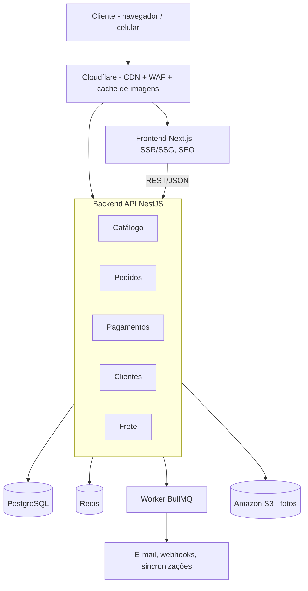

# Documento de Arquitetura de Sistema Web – Desa Pego

| | |
| --- | --- |
| **Projeto** | Desa Pego |
| **Versão** | 1.0 |
| **Data** | 29/10/2026 |
| **Responsável** | Equipe de Arquitetura |
| **Status** | Rascunho |

## 1. Visão Geral

### 1.1 Objetivo do Documento

Este documento descreve a arquitetura técnica do sistema web Desa Pego, definindo os componentes, integrações, padrões e decisões de design que guiam o desenvolvimento e a manutenção da solução.

### 1.2 Escopo

**Dentro do escopo:** vitrine pública, busca e filtros, carrinho, checkout com pagamento, cálculo de frete, painel administrativo (cadastro de peças, pedidos, clientes), e-mails transacionais e relatórios básicos.

**Premissas assumidas:**

- Loja própria (um único vendedor), com possibilidade de evoluir para marketplace ou consignação no futuro.
- Público no Brasil: pagamento via Pix, cartão e boleto; frete via Correios e transportadoras.
- Time pequeno (1 a 5 devs) e orçamento enxuto no início.
- Catálogo de poucos milhares de peças, em sua maioria únicas (estoque de 1 unidade por peça).

### 1.3 Público-Alvo

Este documento é destinado a desenvolvedores, arquitetos de software, DevOps, gerentes de projeto e demais stakeholders técnicos envolvidos no ciclo de vida do sistema.

## 2. Descrição do Sistema

### 2.1 Contexto e Propósito

Brechós físicos têm alcance limitado e processos manuais de controle de peças. O sistema leva o acervo para a internet, permitindo que clientes encontrem e comprem peças de segunda mão com confiança, e que a equipe do brechó cadastre, publique e despache peças com pouco esforço.

**Usuários principais:** clientes compradores, administradores/atendentes do brechó e, futuramente, vendedores consignantes.

**Característica que define a arquitetura:** quase toda peça é única. Duas pessoas não podem comprar a mesma peça ao mesmo tempo, então controle de estoque e reserva são o ponto mais crítico do sistema.

### 2.2 Principais Funcionalidades

- Catálogo com fotos múltiplas, categorias, tamanho, marca, estado de conservação, medidas e preço.
- Busca textual e filtros (tamanho, categoria, faixa de preço, marca, condição).
- Cadastro e login (e-mail/senha e Google), favoritos e histórico de pedidos.
- Carrinho com reserva temporária das peças (ex.: 15 minutos).
- Checkout com Pix, cartão e boleto; cálculo de frete por CEP; rastreio.
- Painel administrativo: cadastro de peças com upload de fotos, gestão de pedidos, cupons e relatórios.
- Notificações por e-mail (confirmação, pagamento, envio, carrinho abandonado).

### 2.3 Requisitos Não Funcionais

| Requisito | Descrição | Meta | Por quê |
| --- | --- | --- | --- |
| Disponibilidade | Uptime esperado | 99,5% no MVP; 99,9% após maturidade | 99,9% exige redundância multi-AZ completa, que encarece; no início 99,5% (cerca de 3,6 h de indisponibilidade por mês) é aceitável para uma loja de pequeno porte |
| Performance | Tempo de resposta | API p95 < 300 ms; LCP (carregamento da página) < 2,5 s | Em e-commerce, lentidão reduz conversão; páginas com muitas fotos exigem otimização de imagem |
| Escalabilidade | Crescimento | Horizontal nos componentes de aplicação | Campanhas e promoções geram picos; instâncias adicionais absorvem o tráfego sem reescrever o sistema |
| Segurança | Conformidade | LGPD, OWASP Top 10, PCI-DSS delegado ao gateway | Dados pessoais e de pagamento são sensíveis; delegar o cartão ao gateway evita manipular dados de cartão |
| Manutenibilidade | Evolução | Alta | Time pequeno precisa de código simples, tipado e com poucos serviços para operar |
| Consistência de estoque | Nunca vender a mesma peça duas vezes | 0 vendas duplicadas | Cada peça é única; vender duas vezes gera cancelamento e perda de confiança |

## 3. Arquitetura Geral

### 3.1 Estilo Arquitetural

**Escolha:** monolito modular (um único backend dividido em módulos bem separados), com processamento assíncrono em workers.

**Por quê:**

- Time pequeno: microsserviços multiplicam custo operacional (deploys, redes, monitoramento, consistência distribuída) sem benefício real nessa escala.
- O fluxo de compra (estoque, carrinho, pedido, pagamento) precisa de transações consistentes. Num monolito isso é uma transação de banco; em microsserviços exigiria padrões complexos (saga, consistência eventual).
- Módulos com fronteiras claras (Catálogo, Pedidos, Pagamentos, Clientes, Frete) permitem extrair um deles para serviço próprio depois, se necessário. É o caminho mais barato para escalar a arquitetura sem reescrever tudo.
- Serverless puro foi descartado por causa de conexões de banco, picos de latência (cold start) e custos imprevisíveis em fluxos de checkout.

### 3.2 Visão de Alto Nível

**Serviços externos:** Mercado Pago (Pix/cartão/boleto), Melhor Envio (frete), Amazon SES (e-mail), Google OAuth, Sentry (erros).

### 3.3 Camadas da Arquitetura

- **Camada de Apresentação (Frontend):** interface da loja e do painel admin. Comunica-se com o backend exclusivamente via API REST.
- **Camada de Aplicação (Backend / API):** regras de negócio (reserva de peças, cálculo de pedido, cupons), orquestração de pagamento e frete, controle de acesso. Expõe endpoints para o frontend e recebe webhooks de pagamento.
- **Camada de Dados:** PostgreSQL como fonte da verdade, Redis para cache, sessões de reserva e filas, S3 para arquivos de imagem.
- **Camada de Infraestrutura:** AWS na região de São Paulo, contêineres gerenciados, balanceador de carga, Cloudflare na borda e monitoramento.

## 4. Componentes e Tecnologias

### 4.1 Frontend

| Item | Escolha | Por quê |
| --- | --- | --- |
| Framework | Next.js (React) com TypeScript | Renderização no servidor (SSR/SSG) deixa as páginas de produto indexáveis no Google, essencial para tráfego orgânico de loja. Ecossistema React é o maior, facilitando contratação. TypeScript evita erros comuns de dados |
| Gerenciamento de estado | TanStack Query (dados do servidor) + Zustand (estado local, ex.: carrinho) | A maior parte do estado de um e-commerce é dado vindo da API; TanStack Query cuida de cache e revalidação. Zustand é leve e simples. Redux seria excesso para este caso |
| Estilização | Tailwind CSS + componentes shadcn/ui | Produtividade alta, visual consistente e bundle pequeno. Permite identidade visual própria, importante para um brechó com estética marcante |
| Build tool | Turbopack/Next.js (embutido) | O próprio Next.js já inclui o build; Vite só faria sentido num SPA sem SSR |
| Biblioteca CSS | Tailwind CSS (escolhida entre Bootstrap, Materialize e Tailwind) | Bootstrap e Materialize deixam o site com cara de template genérico e são mais difíceis de personalizar; Materialize está praticamente sem manutenção ativa. Tailwind entrega CSS enxuto e design livre |
| Imagens | next/image + Cloudflare Images/redimensionamento | Fotos são o produto. Entregar formatos modernos (WebP/AVIF) e tamanhos adequados ao dispositivo melhora muito a velocidade |
| Testes | Vitest (unitário), Testing Library, Playwright (E2E) | Playwright testa o fluxo completo de compra em vários navegadores e é mais estável que alternativas; Vitest é rápido e compatível com o ecossistema |

### 4.2 Backend

| Item | Escolha | Por quê |
| --- | --- | --- |
| Linguagem | TypeScript (Node.js) | Mesma linguagem do frontend: o time compartilha tipos, validações e conhecimento, reduzindo custo e erros de integração. Node lida bem com muitas requisições de I/O, como uma loja |
| Framework | NestJS | Impõe estrutura modular (casa com o monolito modular), injeção de dependência e padrões consistentes. Express puro daria liberdade demais e tende a virar bagunça com o tempo. FastAPI/Spring seriam boas opções, mas dividiriam o time em duas linguagens |
| Protocolo de API | REST (JSON) com documentação OpenAPI | Simples, cacheável e entendido por qualquer integrador. GraphQL adiciona complexidade desnecessária para telas previsíveis; gRPC é voltado a comunicação entre serviços internos, que não teremos |
| Autenticação | JWT de curta duração + refresh token em cookie httpOnly; login social com OAuth 2.0 (Google) | Tokens curtos limitam o dano em caso de vazamento; cookie httpOnly protege contra roubo por XSS. Login com Google reduz fricção e abandono no cadastro |
| ORM | Prisma | Tipagem forte ligada ao schema do banco e migrations integradas |
| Validação | Zod / class-validator | Todo dado de entrada é validado na borda da API, reduzindo falhas e ataques |
| Testes | Jest (unitário/integração) + Supertest | Padrão consolidado no ecossistema NestJS |

### 4.3 Banco de Dados

| Item | Escolha | Por quê |
| --- | --- | --- |
| Banco relacional | PostgreSQL (Amazon RDS) | Pedidos, pagamentos e estoque exigem transações ACID e integridade referencial. Postgres também oferece busca textual, JSONB para atributos variáveis das peças e bloqueios de linha para reservas. Escolhido sobre MySQL pelos recursos mais completos |
| Banco não relacional | Não adotar no MVP | Os dados são naturalmente relacionais; um segundo banco só aumentaria custo e complexidade. Atributos flexíveis das peças cabem em colunas JSONB |
| Cache / filas | Redis (Amazon ElastiCache) | Uma única tecnologia atende cache de catálogo, expiração automática das reservas (TTL), rate limiting e filas |
| Busca | PostgreSQL full-text no início; Meilisearch quando o catálogo ou a exigência de busca crescer | Com milhares de peças, o Postgres resolve bem. Meilisearch traz tolerância a erros de digitação e busca instantânea, e entra apenas se necessário |
| Armazenamento de arquivos | Amazon S3 | Fotos não devem ficar no banco nem no servidor de aplicação; S3 é barato, durável e integra com CDN |
| Migrations | Prisma Migrate | Versiona o schema junto do código e roda automaticamente no pipeline |

### 4.4 Infraestrutura e DevOps

| Item | Escolha | Por quê |
| --- | --- | --- |
| Cloud provider | AWS (região sa-east-1, São Paulo) | Menor latência para o público brasileiro e dados armazenados no país, o que simplifica a conversa sobre LGPD. Catálogo de serviços gerenciados maduro |
| Contêineres | Docker + AWS ECS Fargate | Fargate roda contêineres sem gerenciar servidores. Kubernetes seria excesso de complexidade e custo para uma equipe pequena |
| CI/CD | GitHub Actions | Integrado ao repositório, simples de configurar, com testes, análise de segurança, build e deploy automáticos |
| Infra como código | Terraform | Ambientes reproduzíveis e revisáveis, sem configuração manual |
| Monitoramento | Grafana Cloud (métricas) + Sentry (erros) | Alternativa de bom custo-benefício ao Datadog, que fica caro com o crescimento. Sentry mostra o erro exato no código e na tela do usuário |
| Logs | Amazon CloudWatch Logs | Já integrado ao ECS, sem precisar operar um ELK Stack (pesado para o tamanho do projeto) |
| CDN / WAF | Cloudflare | Cache de imagens e páginas, proteção contra bots e DDoS e firewall de aplicação em um só lugar, com plano gratuito/barato |

## 5. Fluxo de Dados e Integrações

### 5.1 Fluxo Principal de Requisição (compra de uma peça)

1. O cliente abre a página da peça. O Cloudflare serve do cache; se não houver, o Next.js renderiza buscando dados na API.
2. Ao clicar em **Adicionar ao carrinho**, o frontend chama `POST /cart/items`. O backend, numa transação, marca a peça como reservada e cria uma chave no Redis com expiração de 15 minutos.
3. No checkout, o cliente informa CEP; a API consulta o frete no Melhor Envio.
4. O cliente escolhe a forma de pagamento. A API cria o pedido (pendente) e a cobrança no Mercado Pago (Pix gera QR Code).
5. O Mercado Pago envia um webhook confirmando o pagamento. O backend valida a assinatura, muda o pedido para pago e a peça para vendida.
6. O worker envia o e-mail de confirmação e gera a etiqueta de envio.
7. Se a reserva expirar sem pagamento, um job libera a peça de volta ao catálogo.

**Por quê assim:** a confirmação de pagamento vem por webhook (e não pelo navegador do cliente), porque o cliente pode fechar a aba. A reserva com expiração impede que uma peça única fique presa por um carrinho abandonado.

### 5.2 Integrações Externas

| Serviço | Finalidade | Protocolo | Responsável | Por quê |
| --- | --- | --- | --- | --- |
| Mercado Pago | Pix, cartão e boleto | REST + Webhook | Fornecedor / time backend | Maior familiaridade do público brasileiro, Pix nativo e taxas competitivas. Pagar.me ou Stripe são alternativas viáveis atrás da mesma interface |
| Melhor Envio | Cotação de frete, etiquetas, rastreio | REST + Webhook | Fornecedor / time backend | Agrega Correios e transportadoras numa única API, evitando várias integrações |
| Amazon SES | E-mails transacionais | SDK / SMTP | Time backend | Custo muito baixo e já na AWS. Domínio com SPF, DKIM e DMARC para evitar spam |
| Google OAuth | Login social | OAuth 2.0 | Time backend | Reduz fricção no cadastro |
| Sentry | Monitoramento de erros | SDK | Time DevOps | Diagnóstico rápido de falhas em produção |
| Focus NFe (fase 2) | Emissão de nota fiscal | REST | Fornecedor | Entra quando o volume exigir emissão automatizada |

O acesso a cada fornecedor fica atrás de uma interface própria (ex.: `PaymentProvider`), para trocar de gateway sem reescrever o negócio.

### 5.3 Eventos e Mensageria

**Escolha:** BullMQ sobre Redis para filas assíncronas no MVP.

**Processados de forma assíncrona:** envio de e-mails, processamento de webhooks, geração de etiquetas, expiração de reservas, redimensionamento de imagens e e-mails de carrinho abandonado.

**Por quê:** o Redis já existe na arquitetura, então não há mais um componente para operar. RabbitMQ e Kafka são pensados para volumes e topologias muito maiores. Se a confiabilidade das filas virar requisito crítico, a migração para Amazon SQS é direta, pois a camada de worker fica isolada.

## 6. Segurança

### 6.1 Autenticação e Autorização

- Perfis: Cliente, Atendente (pedidos e atendimento) e Administrador (catálogo, usuários, configurações).
- Autorização por papéis (RBAC) validada sempre no backend; o frontend apenas esconde opções, nunca é a barreira de segurança.
- Senhas com hash Argon2id; bloqueio temporário após tentativas falhas.
- Painel administrativo com autenticação em dois fatores (2FA) obrigatória.

**Por quê:** o painel admin controla preços, pedidos e dados de clientes; um acesso indevido seria o maior risco do sistema, por isso o reforço com 2FA.

### 6.2 Proteção de Dados

- **Em trânsito:** TLS 1.2+ (HTTPS obrigatório com HSTS).
- **Em repouso:** criptografia no RDS, S3 e ElastiCache (KMS).
- **Pagamento:** dados de cartão nunca passam pelo nosso servidor; usa-se tokenização do Mercado Pago.
- **LGPD:** base legal e consentimento registrados, política de privacidade, canal para o titular exportar ou excluir seus dados, coleta mínima, retenção definida e anonimização de pedidos antigos quando exigida a exclusão.

**Por quê:** não armazenar cartão elimina quase todo o escopo do PCI-DSS. A LGPD prevê sanções relevantes e a loja guarda CPF, endereço e telefone.

### 6.3 Gestão de Segredos

**Escolha:** AWS Secrets Manager, com permissões por IAM mínimas por serviço. Arquivos `.env` existem apenas localmente, fora do repositório (`.gitignore`), e o pipeline roda detecção de segredos (ex.: gitleaks).

**Por quê:** chaves de API de pagamento vazadas dão prejuízo direto. O Secrets Manager permite rotação e auditoria de acessos.

### 6.4 Práticas de Segurança Aplicadas

Validação e sanitização de entradas, consultas parametrizadas via ORM (proteção contra SQL Injection), escape de saída e CSP (proteção contra XSS), rate limiting em login, busca e checkout, CORS restrito por ambiente, cabeçalhos de segurança (Helmet), WAF do Cloudflare, validação de assinatura em webhooks, upload de imagens com validação de tipo e tamanho, dependências auditadas (Dependabot), análise estática (CodeQL/SAST) e varredura de imagens Docker no pipeline.

## 7. Escalabilidade e Performance

### 7.1 Estratégia de Escalabilidade

Escalabilidade horizontal do backend e do frontend: ambos são stateless (sem estado local), então o ECS adiciona ou remove instâncias por uso de CPU/requisições. O banco escala verticalmente no início, com réplica de leitura para consultas do catálogo quando necessário. Estado (sessões, reservas) vive no Redis e no Postgres, não na memória das instâncias.

**Por quê:** o gargalo típico de uma loja é leitura (navegar no catálogo); separar leitura da escrita resolve a maior parte do problema antes de qualquer reescrita.

### 7.2 Estratégia de Cache

| Camada | Técnica | Por quê |
| --- | --- | --- |
| Borda | Cloudflare cacheia imagens e páginas estáticas | A maior parte do peso são fotos; servir da borda alivia o servidor |
| Frontend | ISR (regeneração incremental) em páginas de categoria e produto | Páginas rápidas e boas para SEO, atualizadas quando a peça muda |
| API | Redis para listagens e filtros populares (TTL curto) | Reduz carga no banco em picos |
| Banco | Índices adequados (categoria, tamanho, status, preço) | Cache não resolve consulta lenta mal indexada |

O estoque e o preço no momento do checkout nunca vêm do cache; sempre são lidos do banco, para não vender uma peça já vendida.

### 7.3 Balanceamento de Carga

AWS Application Load Balancer (ALB) distribuindo o tráfego entre as tarefas do ECS em múltiplas zonas de disponibilidade, com health checks. Cloudflare fica à frente como proxy e proteção.

**Por quê:** o ALB é gerenciado, integra com o ECS e remove instâncias com falha automaticamente.

## 8. Disponibilidade e Recuperação

### 8.1 Estratégia de Backup

- **PostgreSQL (RDS):** backups automáticos diários com retenção de 14 dias e recuperação para qualquer ponto no tempo (PITR).
- **S3 (fotos):** versionamento ativado e replicação para outra região.
- **Teste de restauração trimestral**, pois backup que nunca foi restaurado não é garantia.

**Por quê:** as fotos e o histórico de pedidos são o patrimônio do negócio; perder qualquer um dos dois é inaceitável.

### 8.2 Plano de Recuperação de Desastres (DR)

| Indicador | Meta | Justificativa |
| --- | --- | --- |
| RPO (perda máxima de dados) | 5 minutos | O PITR do RDS permite essa granularidade; pedidos pagos não podem ser perdidos |
| RTO (tempo máximo de recuperação) | 4 horas | Compatível com o orçamento e o porte; a infraestrutura em Terraform permite recriar o ambiente de forma rápida |

**Procedimento:** banco multi-AZ (failover automático); em falha regional, restaurar o banco do backup em outra região e subir a infraestrutura via Terraform, apontando o DNS para o novo ambiente.

### 8.3 Health Checks e Alertas

- Endpoints `/health/live` (processo ativo) e `/health/ready` (banco e Redis acessíveis).
- Alertas (Slack/e-mail) para: taxa de erros 5xx acima de 2%, latência p95 acima de 800 ms, fila de jobs acumulada, falha de webhook de pagamento, disco/conexões do banco acima de 80%.
- Monitor externo de disponibilidade (ex.: UptimeRobot/Better Stack) para o checkout.

## 9. Ambientes

| Ambiente | Finalidade | URL / Endereço | Observações |
| --- | --- | --- | --- |
| Desenvolvimento | Desenvolvimento local | localhost (Docker Compose) | Postgres, Redis e S3 simulado (MinIO) sobem com um comando; pagamentos em modo sandbox |
| Homologação | Testes e validação | homolog.brechoonline.com.br | Espelho da produção em menor escala, com dados fictícios, gateway em sandbox |
| Produção | Uso pelos usuários finais | www.brechoonline.com.br | Multi-AZ, backups e monitoramento completos |

**Por quê:** separar homologação evita testar pagamentos e migrations diretamente em produção. Dados reais de clientes nunca são copiados para ambientes de teste (LGPD).

## 10. Decisões Arquiteturais

### ADR-001: Monolito modular em vez de microsserviços

- **Contexto:** time pequeno, domínio ainda em descoberta, necessidade de consistência no fluxo de compra.
- **Decisão:** um único backend NestJS com módulos isolados, mais workers para tarefas assíncronas.
- **Consequências:** (+) deploy simples, transações locais, menor custo e curva de aprendizado. (−) escalar partes isoladas exige extração futura; mitigado pela separação em módulos desde o início.

### ADR-002: TypeScript de ponta a ponta

- **Contexto:** frontend e backend precisam evoluir juntos e o time é reduzido.
- **Decisão:** Next.js e NestJS, ambos em TypeScript, com tipos e validações compartilhados.
- **Consequências:** (+) menos erros de contrato, contratação e revezamento de tarefas mais simples. (−) Node não é ideal para processamento pesado de CPU, o que não é o caso de uma loja; se surgir, isola-se em um worker.

### ADR-003: Reserva de peça única com bloqueio transacional e TTL

- **Contexto:** cada peça existe uma única vez; vender duas vezes é o pior erro possível.
- **Decisão:** reservar a peça com atualização atômica condicional no PostgreSQL (`UPDATE ... WHERE status = 'disponivel'`), com expiração controlada por TTL no Redis e job de limpeza.
- **Consequências:** (+) garantia forte contra venda duplicada, mesmo com muitos acessos simultâneos. (−) peças reservadas ficam indisponíveis por até 15 minutos para outros clientes; a exibição do status "reservada" ameniza a frustração.

### ADR-004: PostgreSQL como banco principal, sem banco NoSQL no MVP

- **Contexto:** dados fortemente relacionais e transacionais, mas com atributos variáveis por categoria de peça.
- **Decisão:** PostgreSQL com colunas JSONB para atributos flexíveis e full-text search nativo.
- **Consequências:** (+) um banco só, menos custo operacional. (−) a busca avançada pode exigir Meilisearch no futuro; a camada de busca fica isolada para facilitar a troca.

### ADR-005: Pagamentos delegados a gateway com webhooks e idempotência

- **Contexto:** necessidade de Pix, cartão e boleto, minimizando risco e escopo de conformidade.
- **Decisão:** Mercado Pago atrás de uma interface própria; confirmação via webhook assinado; processamento idempotente (o mesmo evento recebido duas vezes não duplica o pedido).
- **Consequências:** (+) sem dados de cartão no nosso ambiente, troca de gateway facilitada. (−) dependência de terceiro e taxas por transação; tratar falhas e reenvios de webhook exige cuidado.

### ADR-006: ECS Fargate em vez de Kubernetes

- **Contexto:** time sem equipe dedicada de infraestrutura.
- **Decisão:** contêineres no ECS Fargate, infraestrutura em Terraform.
- **Consequências:** (+) pouca operação, escala automática, custo previsível. (−) menos portabilidade entre nuvens que o Kubernetes; aceitável nesta fase.

### ADR-007: Renderização no servidor (SSR/ISR) para o frontend

- **Contexto:** o tráfego orgânico (Google, redes sociais) é a principal forma de aquisição de um brechó.
- **Decisão:** Next.js com SSR/ISR nas páginas públicas e dados estruturados (schema.org Product).
- **Consequências:** (+) SEO e velocidade melhores, boa pré-visualização de links ao compartilhar peças. (−) exige servidor para renderização e mais cuidado com cache.

## 11. Glossário

| Termo | Definição |
| --- | --- |
| ACID | Propriedades de transações de banco: atomicidade, consistência, isolamento e durabilidade |
| API | Interface de Programação de Aplicações |
| CDN | Rede de Distribuição de Conteúdo |
| CI/CD | Integração e Entrega Contínua |
| ISR | Regeneração incremental: páginas geradas antecipadamente e atualizadas em segundo plano |
| JWT | JSON Web Token |
| LGPD | Lei Geral de Proteção de Dados (Lei 13.709/2018) |
| Monolito modular | Aplicação única, organizada internamente em módulos independentes |
| PCI-DSS | Padrão de segurança para dados de cartões de pagamento |
| PITR | Recuperação do banco para qualquer ponto no tempo |
| RBAC | Controle de acesso baseado em papéis |
| RPO | Recovery Point Objective: quantidade máxima de dados que se aceita perder |
| RTO | Recovery Time Objective: tempo máximo aceitável para restabelecer o sistema |
| SSR | Renderização no servidor |
| TTL | Time to Live: tempo até um dado expirar automaticamente |
| Webhook | Chamada que um serviço externo faz ao nosso sistema para avisar de um evento |

## 12. Histórico de Revisões

| Versão | Data | Autor | Descrição das Alterações |
| --- | --- | --- | --- |
| 1.0 | 29/10/2026 | Equipe de Arquitetura | Criação do documento |
